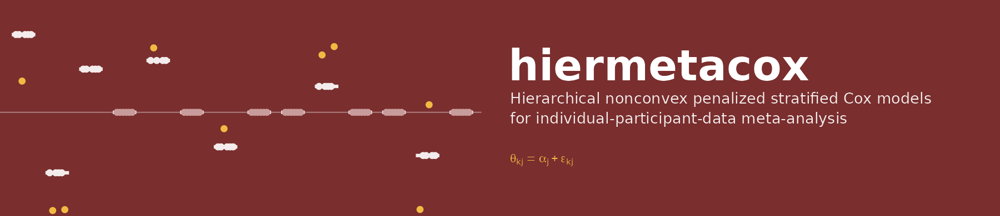

<p align="center">
  
</p>

<p align="center">
  <a href="#method">Method</a> &middot;
  <a href="#installation">Installation</a> &middot;
  <a href="#which-script-produces-which-table">Tables</a> &middot;
  <a href="#which-script-produces-which-figure">Figures</a> &middot;
  <a href="#reproducing-the-results">Reproducing</a> &middot;
  <a href="#notes-on-use">Notes</a> &middot;
  <a href="#citation">Citation</a>
</p>

---

Hierarchical variable selection for individual-participant-data (IPD)
meta-analysis of time-to-event outcomes. Each study keeps its own baseline
hazard; each log-hazard ratio is split into a **global effect** shared across
studies and a **sparse study-specific deviation**; MCP or SCAD penalties with two
tuning parameters select both, and a covariate removed globally is removed from
every study.

Code accompanying *Hierarchical Variable Selection for Nonconvex Penalized Cox
Models in Individual-Participant-Data Meta-Analysis* by Emmanuel Djegou, Bertin
Dehigbe, Jarrad Botchway and Emmanuel Boamah. The R package `hiermetacox` in this
repository implements the method; the `simulation/` and `application/` scripts
reproduce every table and figure of the paper.

---

## Method

For participant `i` of study `k = 1..K`:

```
h_ki(t | x_ki)  =  h_0k(t) * exp( x_ki' theta_k )        stratified Cox model
theta_kj        =  alpha_j + eps_kj                       global + deviation
```

* `h_0k` is an unknown baseline hazard, different in every study, removed by the
  stratified partial likelihood (risk sets never mix studies).
* `alpha` and `eps_k` are **unknown fixed parameters**, not random effects; no
  distribution is assumed for the deviations.

The estimator minimises

```
Q = -(1/N) sum_k l_k(alpha + eps_k)
    + sum_j P(|alpha_j|; lambda_alpha)
    + sum_k sum_j P(omega_k |eps_kj|; lambda_eps),        omega_k = sqrt(n_k / N)
```

over the set `H` defined by two rules:

| Rule | Statement | Why |
|---|---|---|
| Hierarchy | `alpha_j = 0  =>  eps_kj = 0` for all `k` | a globally excluded covariate is excluded everywhere |
| Sharing | every active covariate has at least one study with `eps_kj = 0` | identifies `alpha_j` as the effect shared by non-deviating studies |

The sharing rule replaces the zero-sum constraint of the first version of the
paper, which is incompatible with sparse deviations (one deviating study would
force all others to deviate).

**Penalties.** `penalty = "MCP"` (default), `"SCAD"`, `"lasso"` or `"enet"`
(elastic net, `lambda * (a|b| + (1 - a) b^2 / 2)` with mixing `a = gamma`,
default 0.5, as in `glmnet`). `heterogeneity = FALSE` fits the stratified model
with common effects.

**Algorithm.** Pathwise coordinate descent on the diagonal quadratic surrogate of
the stratified partial likelihood, written in C. Each covariate block
`(alpha_j, eps_1j, ..., eps_Kj)` is updated by exact one-dimensional minimisation
(valid even where the MCP/SCAD coordinate problem is nonconvex), never leaves
`H`, and ends with a likelihood-preserving re-centring move. A step is accepted
only if the true objective does not increase (step-halving otherwise).

**Tuning.** `(lambda_alpha, lambda_eps)` are chosen jointly by `V = 5`-fold
cross-validation over 20 values of `lambda_alpha` times the ratios
`lambda_eps / lambda_alpha` in `{0.5, 1, 2}`. Folds are stratified by study and
event status; the criterion is the cross-validated linear-predictor deviance of
the stratified partial likelihood (Dai & Breheny, 2024), computed from
out-of-fold linear predictors and full-data within-study risk sets. Its standard
error uses the same fold-level quantity: the fold's deviance reduction relative to
the null model, `Delta_v = D_v - D_v(null)`, with `SE = sqrt(V) * sd(Delta_v)`
(centring removes the baseline risk-set terms, which are common to all models).
Both the minimum rule and a one-standard-error rule (fewest nonzero parameters
within one SE) are returned from the same run.

---

## Repository structure

```text
.
├── hiermetacox/                    # the R package
│   ├── src/hmcox.c                   stratified hierarchical coordinate descent (C)
│   ├── R/hmcox.R                     data preparation, path fit, coef/predict
│   ├── R/cv.R                        2-D cross-validation, fold assignment, both rules
│   ├── R/inference.R                 post-selection Wald inference, bootstrap,
│   │                                 simulation generator sim_ipd(), metrics
│   └── tests/testthat/               solver correctness tests
│
├── simulation/                     # Section 5
│   ├── 00_setup.R                    scenarios, tuning constants, the 12 methods
│   ├── 01_run_simulation.R           main study (Sections 5.1-5.4); resumable
│   ├── 02_make_tables_figures.R      Tables 1-3, A1 and Figures 1-4, WITHOUT refitting
│   ├── 03_oracle_study.R             oracle experiment (Section 5.5); resumable
│   ├── 04_oracle_tables_figures.R    Tables 4-6 and Figures 5-6, WITHOUT refitting
│   ├── 05_near_cancellation.R        near-cancellation experiment (Section 5.5); resumable
│   ├── run_all.sh                    runs 01, 03, 05, then 02 and 04
│   └── results/                      per-replicate CSVs, summaries, run log
│                                     (created by the first run)
│
├── application/                    # Section 6
│   ├── 01_prepare_data.R             curatedOvarianData -> analysis data (p = 500)
│   ├── 02_fit_and_infer.R            12 methods, inference, bootstrap, frailty,
│   │                                 fold sensitivity, leave-one-study-out validation
│   ├── 03_make_tables_figures.R      Tables 7-11 and Figures 7-10 from stored results
│   ├── curatedOvarianData.md5        checksums of the six input data files
│   └── results/                      CSV outputs (committed) and RDS objects (not committed)
│
├── output/                         # everything that goes into the paper
│   ├── tables/                       LaTeX tables written by the scripts
│   └── figures/                      PNG figures (300 dpi) written by the scripts
│
├── scripts/
│   ├── quick_test.R                  run this first (about 30 s)
│   └── audit_consistency.R           code <-> manuscript consistency check
│
├── docs/header.png, docs/make_header.R
├── CITATION.cff
└── LICENSE
```

**Every command in this README is run from the repository root.** The scripts
locate their own folder, so they also work when started from elsewhere (for
example `cd simulation && Rscript 01_run_simulation.R 500`), and they always
read and write the same files: `simulation/results/`, `application/results/` and
`output/`.

---

## Which script produces which table

Every table is written as a LaTeX fragment to `output/tables/`, laid out exactly as
in the manuscript, and every figure as a 300-dpi PNG to `output/figures/`. The
manuscript itself is not part of this repository: copy `output/figures/` into the
Overleaf project (the file names are the ones used by `\includegraphics`) and
transfer the table values from `output/tables/`.

| Table | Contents | Produced by | Output (in `output/tables/`) |
|---|---|---|---|
| 1 | Simulation scenarios | `simulation/02_make_tables_figures.R` | `tab_scenarios.tex` |
| 2 | Base scenario, all 12 methods, both rules | same | `tab_sim_base.tex` |
| 3 | Coverage of post-selection Wald intervals | same | `tab_sim_coverage.tex` |
| 4 | Oracle experiment: support recovery, equality with the oracle (top: bounded design; bottom: Gaussian design) | `simulation/04_oracle_tables_figures.R` with `DESIGN=bounded` and `DESIGN=gaussian` (data from `03_oracle_study.R`) | `tab_oracle_selection_bounded.tex`, `tab_oracle_selection.tex` |
| 5 | Oracle experiment, bounded design: bias, SD/SE, coverage, efficiency, normality | `DESIGN=bounded simulation/04_oracle_tables_figures.R` | `tab_oracle_inference_bounded.tex` |
| 6 | Near-cancellation experiment, bounded design: Theorem 4.2 check and algorithm check | same (data from `05_near_cancellation.R`) | `tab_nearcancel_bounded.tex` |
| 7 | Cross-validation criterion: linear predictor vs Verweij–van Houwelingen | `simulation/08_sensitivity_tables.R` (data from `07_sensitivity.R`) | `tab_cv_criterion.tex` |
| 8 | Optimisation sensitivity: folds, tolerance, ratio grid, starting values | same | `tab_sensitivity.tex` |
| 9 | Cohort characteristics | `application/03_make_tables_figures.R` | `tab_cohorts.tex` |
| 10 | Genes selected by each method, CV time | same | `tab_app_methods.tex` |
| 11 | Selected genes: HR, 95% CI, p, stability | same | `tab_app_genes.tex` |
| 12 | Stratified vs frailty vs pooled hazard ratios | same | `tab_app_frailty.tex` |
| 13 | Leave-one-study-out C-index | same | `tab_app_loso.tex` |
| 14 | Multi-split p-values over all 500 genes | `application/04_split_inference.R` | `tab_app_split.tex` |
| A1 | All scenarios, all methods | `simulation/02_make_tables_figures.R` | `tab_sim_all.tex` |

Per-replicate results are in `simulation/results/raw/sXX_rYYY.csv` (main study),
`simulation/results/oracle/nNNNN_rYYY.csv`, `simulation/results/nearcancel/rYYY.csv`
(Gaussian design; the bounded design writes to `oracle_bounded/` and
`nearcancel_bounded/`) and `simulation/results/sensitivity/{A,B}_sXX_rYYY.csv`;
the long-format summaries with Monte Carlo standard errors behind Tables 2-5 are
`simulation/results/sim_summary.csv`, `sim_coverage_summary.csv` and
`oracle_summary.csv` (`oracle_summary_bounded.csv`); the sensitivity summaries by
scenario are `sensitivity_cv_by_scenario.csv` and `sensitivity_opt_by_scenario.csv`. Solver termination for every cross-validation run
(path points that hit the iteration limit or stalled, and how often the selected
`lambda_alpha` is the smallest grid value) is summarised by scenario and method in
`simulation/results/sim_convergence_summary.csv`, which `02_make_tables_figures.R`
writes and also prints in brief.

---

## Which script produces which figure

| Figure | Contents | Produced by | Output (in `output/figures/`) |
|---|---|---|---|
| 1 | MCC by scenario, both rules | `simulation/02_make_tables_figures.R` | `sim_mcc.png` |
| 2 | FDR and TPR by scenario | same | `sim_fdr_tpr.png` |
| 3 | MSE of study-specific effects | same | `sim_mse_theta.png` |
| 4 | Recovery of deviations | same | `sim_deviations.png` |
| 5 | Oracle experiment (bounded design): support recovery and equality with the oracle vs n | `DESIGN=bounded simulation/04_oracle_tables_figures.R` | `oracle_selection_bounded.png` |
| 6 | Oracle experiment (bounded design): normal QQ plots of standardised estimates | same | `oracle_qq_bounded.png` |
| 7 | Kaplan–Meier curves by cohort | `application/03_make_tables_figures.R` | `app_km.png` |
| 8 | Two-dimensional CV curve | same | `app_cv_surface.png` |
| 9 | Global and study-specific hazard ratios | same | `app_forest.png` |
| 10 | Bootstrap selection frequencies | same | `app_stability.png` |

**These filenames are fixed by the `\includegraphics{figures/...}` calls in
`main.tex` and must not be changed.** Uploading `output/figures/` to the Overleaf
project as `figures/` updates every figure without path edits.

---

## Installation

```bash
git clone https://github.com/EmmanuelMasavoDjegou/Hierarchical-Variable-Selection-in-Penalized-Cox-Models-for-IPD-Meta-Analysis.git
cd Hierarchical-Variable-Selection-in-Penalized-Cox-Models-for-IPD-Meta-Analysis
Rscript -e 'install.packages(c("survival", "ggplot2", "testthat", "glmnet"), repos = "https://cloud.r-project.org")'
R CMD INSTALL hiermetacox          # needs a C compiler (Rtools on Windows)
```

or, from R, `remotes::install_github("EmmanuelMasavoDjegou/Hierarchical-Variable-Selection-in-Penalized-Cox-Models-for-IPD-Meta-Analysis", subdir = "hiermetacox")`.

The package itself depends only on `survival`. `ggplot2` is needed by the scripts
that draw figures, `testthat` and `glmnet` only by the package tests. The data
analysis also needs Biobase and, optionally, curatedOvarianData from Bioconductor
(see [Real data](#real-data-section-6) for an alternative):

```bash
Rscript -e 'if (!requireNamespace("BiocManager", quietly = TRUE)) install.packages("BiocManager", repos = "https://cloud.r-project.org"); BiocManager::install(c("Biobase", "curatedOvarianData"))'
```

The code was developed and tested, and the application results reproduced
exactly, with R 4.3.3, survival 3.5-8, ggplot2 3.4.4, Biobase 2.62.0 and glmnet
4.1-8 (glmnet is used only to verify the solver in the package tests).

**ggplot2 4 and S7.** ggplot2 4.x is built on the S7 package, which enables `@` on
ggplot2 objects only if S7 was *installed* under R 4.3.0 or later. A copy of S7
built under an older R (for example in a library folder shared by two R versions, or
a mixed conda/CRAN setup) makes every figure script fail with
`no applicable method for '@' applied to an object of class "theme"`; the scripts
detect this and stop with instructions. The fix is to reinstall both packages under
the R you use:

```bash
Rscript -e 'install.packages(c("S7", "ggplot2"), repos = "https://cloud.r-project.org")'
```

### Quick start

```r
library(hiermetacox)
set.seed(1)
sim <- sim_ipd(K = 5, n = 200, p = 100)                  # the base simulation design
d   <- sim$data                                          # columns study, time, status, X1..X100
X   <- as.matrix(d[, -(1:3)])

fit <- cv.hmcox(X, d$time, d$status, d$study, penalty = "MCP",
                nfolds = 5, ratio = c(0.5, 1, 2), rule = "1se")
fit                                   # selected tuning parameters, model size
cf  <- coef(fit)                      # alpha (p), eps (K x p), theta (K x p)
hmcox_inference(fit)$global           # HR, 95% CI, p-value per selected covariate
hmcox_boot(fit, B = 100)$selection    # bootstrap selection frequencies
```

---

## Verify the installation

```bash
Rscript -e 'testthat::test_dir("hiermetacox/tests/testthat", package = "hiermetacox", load_package = "installed")'
Rscript scripts/quick_test.R
```

The first command runs the package tests against the installed package (11 tests,
419 expectations, a few seconds; it must end with `[ FAIL 0 | ... | PASS 419 ]`).
The tests check the solver against **exact** references rather than
plausibility:

* with no penalty, the common-effect fit equals `survival::coxph(... + strata(study))`
  with Breslow ties, coefficients and log-likelihood;
* with no penalty, the heterogeneous fit equals `K` separate Cox fits;
* the lasso and elastic-net paths equal `glmnet`'s stratified Cox paths, and a
  single-stratum fit equals `glmnet`'s ordinary (unstratified) Cox lasso;
* MCP and SCAD solutions satisfy the Karush–Kuhn–Tucker conditions;
* every fitted model satisfies the hierarchy and the sharing rule at every
  `lambda`, and every training fold contains every study.

`quick_test.R` (about 30 seconds) runs two replicates of the base scenario for
three of the twelve methods (hierarchical MCP, stratified MCP, pooled lasso)
through exactly the functions used by the simulation (`fit_method()`,
`hmc_metrics()`), then fits one cross-validated model and prints its hazard
ratios. It writes nothing to disk.

---

## Reproducing the results

The three parts below are independent. Run times were measured on one core of an
x86-64 Linux machine (Intel Xeon, 2.8 GHz). `NCORES=n` runs replicates in parallel
with `parallel::mclapply` (Linux and macOS; on Windows leave `NCORES` unset).

### Simulation (Sections 5.1-5.4)

```bash
NCORES=8 Rscript simulation/01_run_simulation.R 500    # 13 scenarios x 12 methods, R = 500
Rscript -e 'install.packages(c("S7", "ggplot2"), repos = "https://cloud.r-project.org")'   # S7 built under this R (see Installation)
Rscript simulation/02_make_tables_figures.R            # Tables 1-3, A1 and Figures 1-4 -> output/
```

`01_run_simulation.R [R] [scenario numbers...]` takes the number of replicates
(default 500, the value in the paper) and optionally a subset of scenarios,
numbered as in Table 1 (`1` = Base, ..., `13` = Small studies, p > n_k). **About
45 hours on one core for R = 500 (about 6 hours with `NCORES=8`).** Replicate
`r` of scenario `s` always uses the seed `20260000 + 1000*s + r`, so files from an
earlier R = 50 run are exactly replicates 1-50 and are kept; only 51-500 are computed.
The 12 methods form a full
3 x 4 design: {hierarchical, stratified common effects, naive pooling} x {MCP,
SCAD, lasso, elastic net}. All twelve are fitted by the same `hiermetacox` solver,
tuning grid, cross-validation criterion and folds; naive pooling is the
common-effect model with a single stratum. Each replicate is written to its own
file, `simulation/results/raw/sXX_rYYY.csv` (metrics) and `sXX_rYYY_cov.csv`
(Wald-interval checks), atomically, so the run is resumable and parallel-safe:
re-issue the same command after any interruption and completed replicates are
skipped. Replicate `r` of scenario `s` uses `set.seed(20260000 + 1000 * s + r)`,
so any single replicate can be regenerated in isolation, e.g.
`Rscript simulation/01_run_simulation.R 1 1` (replicate 1 of the Base scenario,
about 15 s). `02_make_tables_figures.R` refits nothing; it aggregates
`simulation/results/raw/` and reports the number of replicates per scenario.

Metrics are recorded at three levels: global support (TPR, FDR, MCC, exact
recovery), deviation support (TPR and FDR of the nonzero deviations), and
coefficients (MSE of alpha, epsilon and theta, plus the error of theta in
near-cancelled cells where a deviation almost cancels the global effect).

### Oracle and near-cancellation experiments (Section 5.5)

```bash
DESIGN=bounded  NCORES=8 Rscript simulation/03_oracle_study.R 200        # assumptions 4.2, 4.4 hold
DESIGN=bounded  NCORES=8 Rscript simulation/05_near_cancellation.R 100   # Theorem 4.2, condition (b)
DESIGN=bounded  Rscript simulation/04_oracle_tables_figures.R            # Tables 4 (top panel), 5, 6; Figures 5-6 -> output/
DESIGN=gaussian NCORES=8 Rscript simulation/03_oracle_study.R 200        # robustness: Gaussian covariates
DESIGN=gaussian NCORES=8 Rscript simulation/05_near_cancellation.R 100
DESIGN=gaussian Rscript simulation/04_oracle_tables_figures.R            # Table 4 (bottom panel) -> output/
```

These experiments check the oracle theory for the proposed hierarchical MCP and SCAD
estimators, with the hierarchical lasso as a negative control, using a fixed truth
(K = 5, p = 100, s0 = 14) and growing study sizes n_k = 200, 400, 800, 1600
(`03_oracle_study.R [R] [sizes...]` accepts a subset). Two designs are run, chosen
with the environment variable `DESIGN`:

* `DESIGN=bounded` (the theory check, added in the revision) satisfies Assumptions
  4.2 and 4.4 exactly: covariates clipped to [-3, 3], censoring hazards fixed in
  advance, and a fixed end of follow-up tau_k. Its constants are computed once by
  `simulation/06_bounded_design_constants.R` (100,000 participants per study) and
  stored in `BOUNDED` in `00_setup.R`. Only the boundary-rate tuning of Remark 4.2,
  lambda = 1.1 sqrt(log(max(p, N)) / N), is run, because the theorems concern a
  deterministic lambda (set `ORACLE_CV=1` to add the two cross-validation rules).
  Seeds `20290000 + 10 * n + r` (oracle) and `20300000 + r` (near-cancellation);
  **about 30 minutes on one core** for both.
* `DESIGN=gaussian` (the default, and the design of the previous version) uses
  unclipped Gaussian covariates, censoring calibrated on each sample and no end of
  follow-up, so it lies outside Assumptions 4.2 and 4.4; it is a robustness check
  and also runs the two cross-validation rules. Seeds `20270000 + 10 * n + r` and
  `20280000 + r`; **about 15 hours on one core**, nearly all of it cross-validation.

For each replicate the oracle experiment records whether the exact support is
recovered, whether the penalised estimate equals the oracle estimate (the
unpenalised fit on the true support), and, for each of the 14 reduced parameters,
the estimate, the oracle estimate and SE, and the coverage of the refitted Wald
interval. The near-cancellation experiment (n_k = 800, R = 100) records whether the
majority representation has the smallest penalty among all feasible
representations of the oracle fit (the claim of Theorem 4.2, checked exactly), and
whether the algorithm returns it or stops at a local minimiser with a larger
objective. Outputs of the bounded design carry the suffix `_bounded`.

### Sensitivity of the cross-validation criterion and of the optimisation (Section 5.6)

```bash
NCORES=8 Rscript simulation/07_sensitivity.R 20     # on the main study's data sets and folds
Rscript simulation/08_sensitivity_tables.R          # Tables 7-8 -> output/
```

`07_sensitivity.R` regenerates exactly the data sets and folds of replicates
1-20 of the main study (same seeds) and runs two experiments. Part A compares, for
hierarchical MCP and SCAD in all 13 scenarios, the models selected by the
linear-predictor criterion of the paper and by the fold-wise criterion of Verweij
and van Houwelingen (1993), both computed from the same cross-validation run
(`cv.hmcox(..., cvtype = "vvh")` selects with the latter; both criteria are always
returned, as `cvm` and `cvm.vvh`). Part B, for hierarchical MCP in three scenarios,
varies the fold assignment (four further seeds), the tolerance (1e-6), the ratio
grid ({1, 2, 4}) and the starting values at the selected (lambda, r) (cold start,
common-effect start and five random perturbations of the solution), recording the
selected support and the objective value. **About 2.5 hours on one core.**

### All simulation experiments in one command

```bash
NCORES=8 sh simulation/run_all.sh
```

runs `01` (R = 500), `03` and `05` in both designs, and `07`, then the table scripts
`02`, `04` (both designs) and `08`, so every simulation table and figure of the
paper is written to `output/`. It stops at the
first error, is resumable, and appends progress to `simulation/results/run_log.txt`
(`tail -f simulation/results/run_log.txt` to follow it). For a long run on a remote
machine, `nohup sh simulation/run_all.sh > /dev/null 2>&1 &` keeps it running after
you log out.

### Real data (Section 6)

```bash
Rscript application/01_prepare_data.R            # analysis data, p = 500 genes; Table 7 data
Rscript application/02_fit_and_infer.R           # all fits, inference, validation (about 7 min)
Rscript application/03_make_tables_figures.R     # Tables 9-13 and Figures 7-10 -> output/
Rscript application/04_split_inference.R 50      # multi-split p-values, Table 14 (about 15 min)
```

`01_prepare_data.R` takes the six cohorts from the installed Bioconductor package
curatedOvarianData (versions from 1.51 download the data on first use, which needs
internet access). If the package cannot be installed, put the six original
`*_eset.rda` files in `application/curatedOvarianData/data/`, where the script
looks for them first. They were removed from the package's GitHub repository in
May 2026, but the last commit that has them is `42c144d`, and the following
fetches only those six files (about 170 MB):

```bash
git clone --filter=blob:none --no-checkout https://github.com/waldronlab/curatedOvarianData application/curatedOvarianData
git -C application/curatedOvarianData checkout 42c144d -- data/TCGA_eset.rda data/GSE32062.GPL6480_eset.rda data/GSE9891_eset.rda data/GSE26712_eset.rda data/GSE17260_eset.rda data/GSE30161_eset.rda
(cd application && md5sum -c curatedOvarianData.md5)    # six lines ending in OK
```

These are the files the paper's results were computed from. Any other folder
holding them can be used with `COD_DATA_DIR=/path/to/folder Rscript application/01_prepare_data.R`.
The folder `application/curatedOvarianData/` is ignored by git.

`01_prepare_data.R` takes about a minute and prints the cohort table (N = 1,446,
735 deaths, 12,249 genes common to all cohorts). `02_fit_and_infer.R` fits the
twelve methods with five-fold CV (fold seed 2026), the post-selection inference
and 100 bootstrap refits (seed 7) for hierarchical MCP under the minimum rule, the
frailty comparison, the ten-fold sensitivity analysis, and the leave-one-study-out
validation (seed 11). It caches its intermediate results in
`application/results/*.rds` and `application/results/loso/` (about 150 MB, not
committed) and skips any step whose cache exists, so delete those files to
recompute from scratch. The small CSV outputs behind every application table are
committed in `application/results/`; a rerun reproduces them exactly except the
CV-time column of `table_methods.csv` (Table 8), which is wall-clock time and
depends on the machine. `03_make_tables_figures.R` needs the `.rds` files, so run
`01` and `02` first.

`04_split_inference.R` (added in the revision) computes multi-split p-values
(Meinshausen, Meier and Buehlmann, 2009) for all 500 genes: in each of 50 random
half-splits of every cohort, hierarchical MCP is selected on one half and the
selected model is refitted on the other, and the Bonferroni-adjusted per-split
p-values are aggregated. These control the family-wise error rate over the 500
candidates asymptotically, unlike the Holm-adjusted p-values over the selected genes
in `table_genes.csv`, which do not account for the selection. Seeds `4000 + b`
(split) and `5000 + b` (folds).

---

## Data availability

| Data set | Studies | N | p | Status |
|---|---|---|---|---|
| Simulation, main study | 5–10 | 500–1,000 | 100–500 | generated by `sim_ipd()` |
| Simulation, oracle and near-cancellation | 5 | 1,000–8,000 | 100 | generated by `sim_ipd()` |
| curatedOvarianData | 6 | 1,446 (735 deaths) | 500 | public, Bioconductor |

The six cohorts are TCGA, GSE32062.GPL6480, GSE9891, GSE26712, GSE17260 and
GSE30161 from the Bioconductor package **curatedOvarianData** (Ganzfried et al.,
2013); [Real data](#real-data-section-6) explains how to obtain the six files
without the package. The 500 genes are chosen without using the outcome: genes measured in all six cohorts (12,249) are ranked
by their average within-cohort interquartile-range rank and the top 500 are kept.

---

## Notes on use

**Coefficients are per within-study standard deviation.** `hmcox()` standardises
each covariate within each study by default, so `exp(alpha_j)` is a hazard ratio
per one-SD increase in the study's own distribution. This removes platform and
batch scale differences between cohorts, which is why it is the default.

**Which tuning rule.** The two rules target different aims (a short list of
covariates versus accurate study-specific estimates), and the simulation study of
the paper compares them; its findings apply to designs like ours rather than as a
general rule, so we recommend reporting both. In the ovarian data the minimum
rule selects 6 genes and the one-standard-error rule 2. Both rules come from one CV run
(`coef(fit, rule = "min")`, `coef(fit, rule = "1se")`).

**Wald intervals are conditional on the selected model.** `hmcox_inference()`
refits the unpenalised stratified Cox model on the selected support. The oracle
theorem makes these intervals asymptotically valid under correct selection; in
finite samples they ignore selection uncertainty. Read them next to the bootstrap
selection frequencies from `hmcox_boot()`, and see Table 3 for their empirical
coverage.

**A small `alpha_j` with large deviations is a signal, not noise.** Under the
hierarchy a covariate that acts in only a minority of studies must still have a
nonzero global effect. The fit then keeps `alpha_j` small and puts the effect in
the deviations; the first-order condition for `alpha_j` then holds only as an
inequality (the constraint is active). Such covariates are the study-specific
signals the method is designed to expose.

**Prediction for a new study uses `alpha` only.** Deviations are fixed effects of
the observed studies. `predict()` uses `alpha` for any study label not seen in
training, which is what the leave-one-study-out validation does.

**The path is truncated at 100 active global effects** (`dfmax`), and the smallest
`lambda_alpha` is 5% of the largest. The `boundary` column of the simulation
output records, for every fit, whether cross-validation selected the smallest
`lambda_alpha` of the grid, so you can check after your run that the grid was wide
enough.

---

## Audit

```bash
Rscript scripts/audit_consistency.R                        # code side
Rscript scripts/audit_consistency.R path/to/main.tex       # + your manuscript copy
```

Each check prints `PASS` or `FAIL`, and the exit status is non-zero if any
fails. The code-side checks confirm that every table and figure exists in
`output/`; that there are exactly 13 x 50 main-study, 4 x 200 oracle and 100
near-cancellation replicate files; that every replicate has all 12 methods; that
no fit violates the hierarchy; and that the simulation tables are newer than the
raw results. Given the path to a copy of `main.tex` (for example downloaded from
Overleaf, with `references.bib` next to it), it also checks that every
`\includegraphics` file is produced in `output/figures/` and every produced figure
is used; that no `\TBD` placeholder, `TODO` or `FIXME` remains; that the tuning
constants and design stated in the manuscript (folds, ratio grid, grid length,
`kappa`, `d_max`, `K`, `n_k`, `p`, `R`) equal those in `simulation/00_setup.R`;
and that every citation resolves. Before the final runs, the replicate-count,
missing-file and `\TBD` checks fail by design.

---

## Citation

If you use this code, please cite the paper:

> **E. Djegou**, B. Dehigbe, J. Botchway & E. Boamah. *Hierarchical Variable
> Selection for Nonconvex Penalized Cox Models in Individual-Participant-Data
> Meta-Analysis.* Preprint.

Machine-readable metadata is in `CITATION.cff`. The code is released under the
MIT licence; see `LICENSE`.
